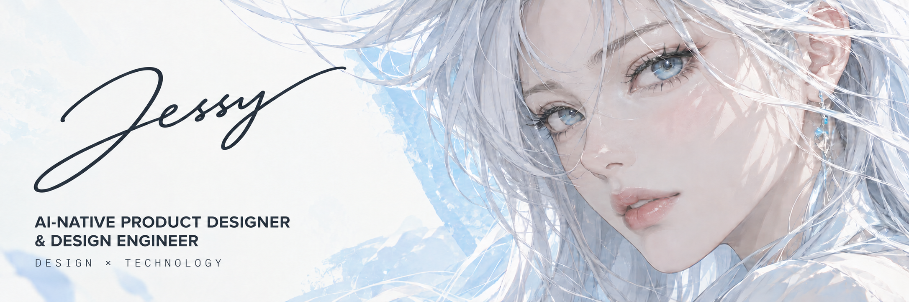
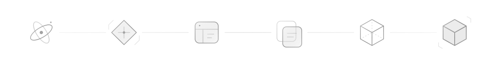

Brand · UI/UX · Interaction · AI-assisted Development

## Design × Technology

> **I don't stop at mockups.**
>
> I use AI-assisted development to take ideas beyond design files — into products that run, interact and evolve.

## From Idea to Product

**IDEA → PRODUCT → DESIGN → PROTOTYPE → BUILD → SHIP**

Product thinking sets the direction. UI/UX and interaction shape the experience. Prototypes and AI-assisted development turn it into a working product.

## The Practice

- **PRODUCT** — Product Design · UI/UX · Interaction · Design Systems
- **BUILD** — Web & Desktop Apps · Interactive Experiences · Creative Software · Web Games
- **AI** — Codex · AI-assisted Development · Rapid Prototyping · AI Coding Workflows
- **VISUAL** — Brand · Visual Systems · 3D · Motion

## Selected Work

Private products & experiments are currently in development.

*Public case studies coming soon.*

## Currently

Exploring how AI is reshaping the boundary between designers and developers.

Building private products and experiments.
